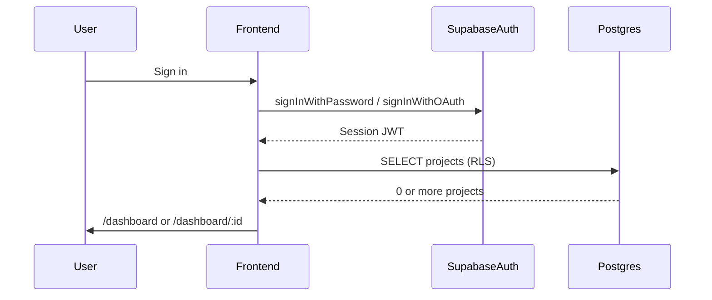

# Phase 2 — Authentication

## Purpose

Add Supabase Auth to the ContOS frontend: email/password and Google OAuth sign-up/sign-in, session persistence, protected routes, and post-authentication routing based on whether the user has projects.

## Implementation overview

| Area | Location |
| --- | --- |
| Supabase client | `Frontend/src/lib/supabase.ts` (`flowType: 'pkce'`, `detectSessionInUrl: true`) |
| Auth actions | `Frontend/src/lib/auth.ts` |
| Project routing helpers | `Frontend/src/lib/projects.ts` |
| Session provider | `Frontend/src/contexts/AuthProvider.tsx` |
| Auth hook | `Frontend/src/hooks/useAuth.ts` |
| Route guards | `Frontend/src/components/ProtectedRoute.tsx`, `GuestRoute.tsx` |
| Pages | `LoginPage`, `SignUpPage`, `AuthCallbackPage`, `DashboardPage` |

## Routes

| Path | Access | Behavior |
| --- | --- | --- |
| `/login` | Guest only | Email/password + Google sign in |
| `/signup` | Guest only | Email/password + Google sign up |
| `/auth/callback` | Public | Completes OAuth PKCE exchange (20s timeout; error UI on failure) |
| `/dashboard` | Authenticated | Redirects to active project or empty state |
| `/dashboard/:projectId` | Authenticated | Project workspace preview |

Unauthenticated users hitting protected routes are redirected to `/login`.

## Post-authentication redirect

After sign-in (email or Google):

1. Load the user's projects via RLS-scoped Supabase query
2. **No projects** → `/dashboard` with "Create your first project" empty state
3. **Has projects** → `/dashboard/:projectId` using last-used project from `localStorage`, or the oldest project

## Supabase Auth configuration checklist

Verify in [Supabase Dashboard → Authentication](https://supabase.com/dashboard/project/aoaoloxnzhvyvvdjcbcr/auth/providers):

### Site URL & redirect URLs

Add these **Redirect URLs** (Authentication → URL Configuration):

- `http://localhost:5173/auth/callback`
- `http://localhost:5174/auth/callback`
- `https://contos-product.vercel.app/auth/callback` (production)
- Any other deployed preview/production origin + `/auth/callback`

**Site URL** (dev): `http://localhost:5173`  
**Site URL** (production): `https://contos-product.vercel.app`

Confirm Vercel env has matching `VITE_SUPABASE_URL` and `VITE_SUPABASE_ANON_KEY` for this project.

### Vercel SPA routing

`Frontend/vercel.json` rewrites all routes to `index.html` so client-side routes (`/login`, `/auth/callback`, `/dashboard`, etc.) work on direct navigation and refresh in production.

### Email provider

- Email sign-up/sign-in enabled
- If email confirmation is required, sign-up shows: "Check your email to confirm your account"

### Google OAuth

- Google provider enabled with client ID + secret
- Authorized redirect URI in Google Cloud Console must include:
  `https://aoaoloxnzhvyvvdjcbcr.supabase.co/auth/v1/callback`

### Database verification (MCP)

- `auth.users` table accessible
- RLS on `public.projects` scopes project reads to `auth.uid()`

## Architecture

## Security review

- Anon key only in frontend; no service-role key exposed
- Sessions persisted by Supabase client (localStorage)
- OAuth uses explicit `flowType: 'pkce'` on `createClient` plus `exchangeCodeForSession` on `/auth/callback`
- `AuthProvider` skips heavy `getUser()` validation on `/auth/callback` to avoid racing PKCE exchange
- Callback page enforces a 20s timeout so hung network calls surface an error instead of an infinite spinner
- Protected routes block unauthenticated access
- Project queries subject to RLS from Phase 1

## Manual test plan

1. Visit `/dashboard` while logged out → redirected to `/login`
2. Sign up with email/password → empty dashboard or project route
3. Sign out → returned to login
4. Sign in with Google → lands on `/auth/callback?code=...` then dashboard/onboarding (must not stick on “Completing sign in…”)
5. Deny Google OAuth → error UI with link back to `/login`
6. Create a project manually in Supabase (or wait for Phase 3) → sign in routes to that project
7. Confirm Postiz `/auth/postiz/callback` is unchanged and still works from Calendar

## Known limitations

- "New project" button is disabled until Phase 3
- Full sidebar dashboard layout arrives in Phase 5
- Cross-user RLS isolation test still requires two accounts (see `Docs/phase-1-schema.md`)

## Future improvements

- Phase 3: wire "Create your first project" to project creation flow
- Password reset / magic link flows
- Display auth init errors in a global error boundary
