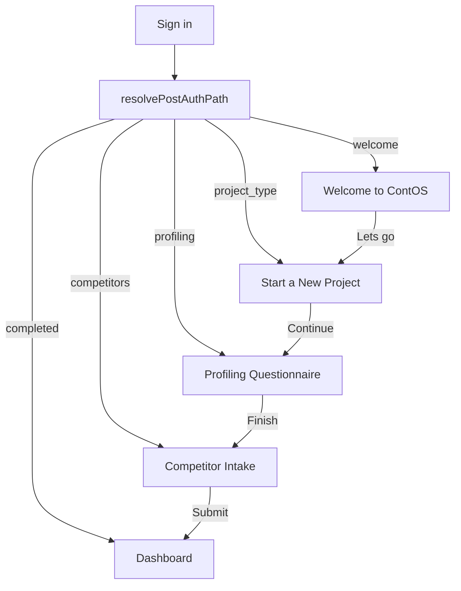

# Multi-Step Welcome Onboarding

## Purpose

Guide new ContOS users through first-run setup after sign-in: product introduction, workspace type selection, full profiling questionnaire, and competitor intake. Returning users and users who have completed onboarding bypass all onboarding screens and land directly on the dashboard.

## Flow



Users who drop mid-flow resume at their saved `onboarding_step` on next login. Within profiling, answers already saved on the avatar hydrate and the UI resumes at the first unanswered **required** question.

## Profiling questionnaire

Sequence for every project:

1. **Common questions (6)** — all project types
2. **Type-specific (20)** — Personal Brand bank **or** Business bank (`business_1` / `business_2` / legacy `business` share the same Business bank)
3. **Final optional** — “Is there anything else you’d like us to know…?”

**UI source of truth:** `public.profiling_questionnaires` — **2 rows** (`personal_branding`, `business`), each with a `questions` JSONB array (27 question objects). Loaded at runtime via `fetchProfilingQuestionnaire(type)` in [`Frontend/src/lib/profiling.ts`](../Frontend/src/lib/profiling.ts). Avatar types `business`, `business_1`, and `business_2` share the `business` row.

[`Frontend/src/config/onboardingProfilingQuestions.ts`](../Frontend/src/config/onboardingProfilingQuestions.ts) keeps shared **types and helpers** only (select matching, competitor name serialize/parse).

### Storage

**Questions catalog:** `public.profiling_questionnaires` — one row per questionnaire template; all question metadata lives in the `questions` JSONB array.

**Answers:** `avatars.profiling_data` (JSONB) keyed by `question_key`. Each response is stored **with the question text**:

```json
{
  "content_goal": {
    "question_key": "content_goal",
    "question": "What is the primary goal of your content?",
    "answer": "Thought Leadership & Authority Building"
  }
}
```

Legacy plain-string values are still read. Association: authenticated user + project via `avatars.user_id` / `avatars.id`; type via `avatars.type`.

- Multiple-choice values store the **full option label** in `answer`, never letter codes.
- “Other” / “Someone else” stores the free-text description in `answer`.
- `top_competitors` stores up to three names as `Name1 | Name2 | Name3`.
- Optional keys (`website_url`, `anything_else`) may be omitted when skipped.
- Resume (`firstUnansweredQuestionIndex`) starts at question 1 when `profiling_data` has no answers yet, so the optional website URL is still shown first. After any answer exists, resume jumps to the first incomplete **required** question (optional empties are not re-prompted mid-flow; use Back to edit them).

Completeness counts **required** active questions only (string or object-with-answer).

### Profile summary (chatbot context)

When the user finishes the last profiling question, the frontend calls **`POST /api/profiling/summarize`** on the Agents API. That endpoint returns **`202 Accepted`** and enqueues a Celery `website` queue job (Redis). The client then polls `avatars.profile_summary_status` (default overall timeout **240s**) until `completed` or `failed`. See [`Docs/phase-celery.md`](./phase-celery.md).

The worker:

1. If `profiling_data.website_url` is present — crawl with Apify **Website Content Crawler** (`apify/website-content-crawler`), LLM-summarize the pages, and store **`avatars.website_summary*`** (replace in place on URL change; skip when no URL).
2. Generate the overall **`avatars.profile_summary*`** from questionnaire answers **plus** `website_summary` when available (Gemini via OpenRouter, env `PROFILE_SUMMARY_MODEL`).

Website crawl/summarize failures are **non-fatal**: status is set to `failed` / `skipped`, and overall profile summary still runs from Q&A only. Raw crawl text is **not** persisted — only the summarized website context.

| Column                         | Purpose                                             |
| ------------------------------ | --------------------------------------------------- |
| `profile_summary`              | Concise structured summary for chat personalization |
| `profile_summary_status`       | `pending` / `generating` / `completed` / `failed`   |
| `profile_summary_generated_at` | Last successful generation timestamp                |
| `profile_summary_source_hash`  | Hash of `profiling_data` used for idempotent skip   |
| `profile_summary_error`        | Last failure message (if any)                       |
| `website_summary`              | LLM markdown from crawled website (optional URL)    |
| `website_summary_status`       | `pending` / `generating` / `completed` / `failed` / `skipped` |
| `website_summary_url`          | Normalized URL that was crawled                     |
| `website_summary_source_hash`  | Hash of normalized URL (idempotent replace)         |
| `website_summary_generated_at` | Last successful website summary timestamp           |
| `website_summary_error`        | Last website crawl/summary failure (if any)         |

**Env (Agents, often via `Backend/.env`):** `APIFY_API_TOKEN`, `APIFY_WEBSITE_CRAWLER_ACTOR_ID`, `WEBSITE_CRAWL_WAIT_SECS`, `WEBSITE_CRAWL_MAX_PAGES`, `WEBSITE_CRAWL_MAX_DEPTH`, `REDIS_URL`.

- **Raw answers** remain in `profiling_data` (source of truth).
- Summary fields are **server-written only** (Supabase trigger blocks client updates).
- On LLM failure, onboarding still advances; status is set to `failed` for retry (edit profiling or lazy refresh on chat).
- Chatbot context prefers `profile_summary`, then uses `website_summary` as supplemental site context, then raw `profiling_data`.

### Common Q6 vs Competitor Intake

| Step                        | What it collects                                   |
| --------------------------- | -------------------------------------------------- |
| Profiling `top_competitors` | Free-text competitor **names** for profile/context |
| Competitor Intake           | Instagram/LinkedIn **handles/URLs** + scrape jobs  |

Both remain in the flow.

### UX

[`ProfilingStep`](../Frontend/src/components/project-setup/ProfilingStep.tsx) supports text, textarea, URL, single-select (+ Other), and competitor-name fields. Shared hook: [`useProfilingQuestionnaire`](../Frontend/src/hooks/useProfilingQuestionnaire.ts). Used by onboarding and `/projects/new` as a step wizard.

**Dashboard Profiling tab** (`/dashboard/:projectId/profiling`): when `profiling_completeness === 100`, shows a scrollable review list ([`ProfilingReviewPanel`](../Frontend/src/components/dashboard/ProfilingReviewPanel.tsx)) so users can edit any answer without stepping through every question. Incomplete profiling still uses the step wizard until all required questions are answered.

## Routes

| Route                     | Page                        | Step           |
| ------------------------- | --------------------------- | -------------- |
| `/welcome`                | `WelcomeOnboardingPage`     | `welcome`      |
| `/onboarding/project`     | `OnboardingProjectTypePage` | `project_type` |
| `/onboarding/profiling`   | `OnboardingProfilingPage`   | `profiling`    |
| `/onboarding/competitors` | `OnboardingCompetitorsPage` | `competitors`  |

Protected app routes (`/dashboard`, `/projects/new`, etc.) remain behind `RequireOnboardingComplete`.

## Persistence

### Table: `public.user_profiles`

| Column                      | Type                   | Description                                                        |
| --------------------------- | ---------------------- | ------------------------------------------------------------------ |
| `user_id`                   | `uuid` PK              | References `auth.users.id`                                         |
| `onboarding_step`           | `text`                 | `welcome`, `project_type`, `profiling`, `competitors`, `completed` |
| `onboarding_avatar_id`      | `uuid` nullable        | Avatar created during project type step                            |
| `onboarding_project_type`   | `text` nullable        | Selected workspace type                                            |
| `onboarding_completed_at`   | `timestamptz` nullable | Set when competitor intake finishes                                |
| `created_at` / `updated_at` | `timestamptz`          | Audit timestamps                                                   |

### Avatar types

Extended to: `personal_branding`, `business`, `business_1`, `business_2`.

First-run project type screen offers Personal Brand, Business 1, and Business 2.

## Implementation

- **Service layer:** [`Frontend/src/lib/onboarding.ts`](../Frontend/src/lib/onboarding.ts)
- **Profiling service:** [`Frontend/src/lib/profiling.ts`](../Frontend/src/lib/profiling.ts) — fetches questions from Supabase and maps rows to UI defs
- **Step guard:** [`Frontend/src/hooks/useOnboardingStepGuard.ts`](../Frontend/src/hooks/useOnboardingStepGuard.ts)
- **Profiling types/helpers:** [`Frontend/src/config/onboardingProfilingQuestions.ts`](../Frontend/src/config/onboardingProfilingQuestions.ts)
- **Competitor intake hook:** [`Frontend/src/hooks/useCompetitorIntake.ts`](../Frontend/src/hooks/useCompetitorIntake.ts)
- **Post-auth routing:** [`Frontend/src/lib/projects.ts`](../Frontend/src/lib/projects.ts) → `resolvePostAuthPath()`

## Migrations

1. `supabase/migrations/20260831120000_user_profiles_onboarding.sql` — initial `user_profiles` table
2. `supabase/migrations/20260831130000_onboarding_steps_and_avatar_types.sql` — step columns + extended types
3. `supabase/migrations/20260831200000_full_profiling_questionnaire.sql` — `is_required`, reseed catalog, required-aware completeness
4. `supabase/migrations/20260831210000_profiling_questions_db_source_of_truth.sql` — UI metadata columns + full seed; frontend loads catalog from DB only
5. `supabase/migrations/20260831220000_normalize_profiling_questions.sql` — intermediate normalization (superseded)
6. `supabase/migrations/20260831230000_profiling_questionnaires_jsonb.sql` — single table, 2 JSONB rows
7. `supabase/migrations/20260831240000_avatar_profile_summary.sql` — profile_summary columns + server-only write guard

## Configuration

No new environment variables. Uses existing Supabase client (`VITE_SUPABASE_URL`, `VITE_SUPABASE_ANON_KEY`).

## Shared project-setup UI

First-run onboarding and dashboard **Start a New Project** (`/projects/new`) share the same step UIs:

- `Frontend/src/components/project-setup/ProjectTypeStep.tsx`
- `Frontend/src/components/project-setup/ProfilingStep.tsx`
- `Frontend/src/components/project-setup/CompetitorsStep.tsx`

| Path            | Persistence                                                                                                               |
| --------------- | ------------------------------------------------------------------------------------------------------------------------- |
| `/onboarding/*` | Advances `user_profiles.onboarding_step`; competitors calls `completeOnboarding()`                                        |
| `/projects/new` | Local wizard only: `createAvatar` → profiling answers → competitors → dashboard. Does **not** touch onboarding completion |

## Known Limitations

- Website URL triggers Apify Website Content Crawler + `website_summary` after profiling; raw pages are not shown in the UI.
- Competitor intake UI is unchanged (Instagram/LinkedIn form).
- Dashboard new project has no explicit name step (matches onboarding auto-naming).

## Security

- RLS on `user_profiles`: users read/update only their own row.
- Onboarding state is server-persisted, not browser-local.
- Avatar and profiling writes go through existing Supabase RLS on `avatars`.
- No secrets in client; optional website URL is user-owned profile data only.
